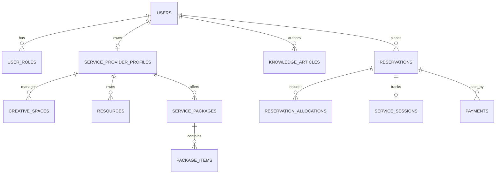

# Kiến trúc Hệ thống & Mẫu Thiết kế – FPDP

## 1. Kiến trúc tổng thể (Modular Monolith + AI Microservice)

- **Backend API (`backend/`)**: Thiết kế theo kiến trúc phân lớp sạch (Controller -> Service -> Repository/Domain), áp dụng triệt để các Design Pattern hướng đối tượng.
- **AI Service (`ai/`)**: Microservice Python FastAPI độc lập, giao tiếp với Backend qua hợp đồng `AIServicePort` (Hexagonal / Ports & Adapters).
- **Data Layer (`infra/`)**:
  - **PostgreSQL 16 + `pgvector` + `btree_gist`**: Lưu trữ dữ liệu giao dịch, ràng buộc chống trùng lịch và vector ngữ nghĩa 768 chiều.
  - **Redis 7**: Lưu phiên đăng nhập, cache kết quả tìm kiếm và khóa phân tán ngắn hạn.
  - **MinIO**: Lưu trữ ảnh phòng tối, ảnh phim gốc và ảnh phim đã phục chế qua AI.

## 2. Các Design Pattern áp dụng trong Class Diagram

1. **Composite Pattern (`Bookable`, `CreativeSpace`, `Resource`, `ServicePackage`, `PackageItem`)**: Cho phép đặt lẻ từng phòng/thiết bị hoặc đặt nguyên gói combo thông qua cùng một giao diện `Bookable.isAvailable()` và `Bookable.calculateCost()`.
2. **Strategy Pattern (`PricingStrategy`, `StandardPricingStrategy`, `DynamicAIPricingStrategy`)**: Cho phép `ReservationService` chuyển đổi linh hoạt giữa bảng giá cố định theo giờ và bảng giá động theo hệ số nhu cầu AI (`demandFactor`).
3. **Observer Pattern (`DomainEventObserver`, `NotificationService`, `InventoryAlertService`)**: Tự động phát sự kiện miền khi đặt chỗ thành công hoặc khi vật tư tiêu hao chạm ngưỡng `minThreshold`.
4. **State Pattern (`ReservationStatus`, `Reservation`, `ServiceSession`)**: Kiểm soát chặt chẽ chuyển đổi trạng thái đặt chỗ từ `PENDING` -> `CONFIRMED` -> `IN_SESSION` -> `COMPLETED`.
5. **Ports & Adapters (`AIServicePort`)**: Tách biệt hoàn toàn nghiệp vụ đặt chỗ cốt lõi khỏi chi tiết triển khai các mô hình AI/LLM.

## 3. Sơ đồ quan hệ thực thể (ERD rút gọn)

